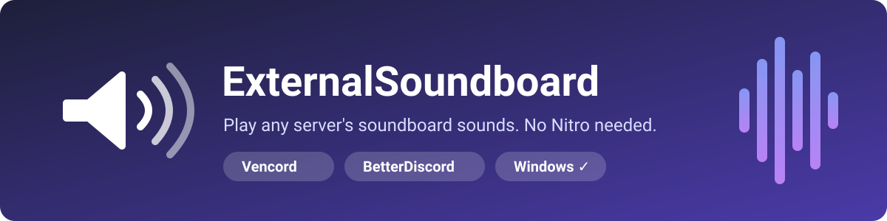
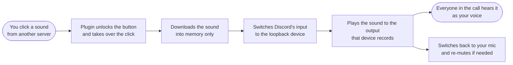

<p align="center">
  
</p>

Play soundboard sounds from **other servers** in a voice call **without Nitro**, and have everyone in the call actually hear them. Available for **Vencord** and **BetterDiscord**, with the same logic in both.

> **Risk:** this works around a paid Discord feature. Client mods already go against Discord's Terms of Service, and this goes a step further. Use it at your own risk; your account could be actioned.

## Quick install

Pick your client. Close Discord first. Each installer checks what you have, tells you what is missing, and does the rest.

### Vencord (one command)

Needs [Git](https://git-scm.com) and [Node.js 22+](https://nodejs.org). The installer downloads and builds Vencord for you (custom plugins can't use Vencord's normal installer), adds this plugin, and asks which Discord to patch: **Stable, Canary, PTB**, or several.

| OS | Run this |
|---|---|
| **Windows** | Download [`install-windows.bat`](install-windows.bat) and double-click it. Or paste in PowerShell:<br>`irm https://raw.githubusercontent.com/Ivan-Ryukendo/ExternalSoundboard/main/install.ps1 \| iex` |
| **macOS / Linux** | `curl -fsSL https://raw.githubusercontent.com/Ivan-Ryukendo/ExternalSoundboard/main/install.sh \| bash` |

Already have a Vencord source folder (for example `~/Vencord`)? The installer finds and reuses it, and it skips the rebuild and the Discord patch when nothing changed. The ready-made Vencord from vencord.dev has no source code, so it can't take a custom plugin. This installer builds a copy that can.

Then restart Discord and enable **ExternalSoundboard** in *Settings > Vencord > Plugins*. Run the same command again later to update. Prefer to do it by hand? See [docs/install-vencord.md](docs/install-vencord.md).

### BetterDiscord

1. Install [BetterDiscord](https://betterdiscord.app).
2. Download [`ExternalSoundboard.plugin.js`](betterdiscord/ExternalSoundboard.plugin.js) into BetterDiscord's plugins folder (*Settings > BetterDiscord > Plugins > Open Plugins Folder*) and enable it.

Details and a self-check: [docs/install-betterdiscord.md](docs/install-betterdiscord.md).

### Uninstall

Close Discord, then run the uninstaller. It asks what to remove: the plugin only, the plugin plus Vencord, the plugin plus BetterDiscord, or everything. It un-patches Discord before deleting anything, removes the plugin's saved settings, and never deletes a Vencord folder you made yourself. Your Vencord and BetterDiscord settings, themes and other plugins are kept unless you say otherwise.

| OS | Run this |
|---|---|
| **Windows** | Double-click [`uninstall-windows.bat`](uninstall-windows.bat), or in PowerShell:<br>`irm https://raw.githubusercontent.com/Ivan-Ryukendo/ExternalSoundboard/main/uninstall.ps1 \| iex` |
| **macOS / Linux** | `curl -fsSL https://raw.githubusercontent.com/Ivan-Ryukendo/ExternalSoundboard/main/uninstall.sh \| bash` (same menu; untested on macOS and Linux) |

### Last step for both: a loopback audio device

The plugin sends the sound out as microphone input, so your computer needs an input that records your speakers (Stereo Mix, VB-Cable, BlackHole, a Linux monitor). **[docs/audio-setup.md](docs/audio-setup.md)** compares the options. In short: Stereo Mix is the quick start but leaks your video or music into your voice, and VB-Cable (Windows) or BlackHole (macOS) keeps only the soundboard in.

## How it works

Discord's server rejects cross-server sounds without Nitro (HTTP 403, code 20015). A client patch can only unlock the button and play the sound on your side, so nobody else hears it. This plugin makes the sound leave as your voice instead.



Nothing is written to disk.

## Status

What has been tested, and what has not:

| | Vencord | BetterDiscord | Loopback device |
|---|---|---|---|
| **Windows** | ✅ Tested | ✅ Tested | ✅ Stereo Mix tested, VB-Cable not tested |
| **macOS** | ⬜ Not tested | ⬜ Not tested | ⬜ BlackHole, not tested |
| **Linux** | ⬜ Not tested | ⬜ Not tested | ⬜ PulseAudio / PipeWire, not tested |
| **Android / iOS** | ❌ Not possible | ❌ Not possible | n/a |

| Installer | Windows | macOS / Linux |
|---|---|---|
| One-command uninstall | ✅ Tested on a throwaway copy of the folder layout. Not run against a real Discord yet | ⬜ Not tested |
| One-command Vencord install | ✅ Tested end to end on Stable Discord (download, build, plugin, patch, re-run skips what is done) | ⬜ Not tested |

"Not tested" means the code is shared and should work, but nobody has confirmed it. Please open an issue with what you find.

## Roadmap

- [x] Vencord plugin, tested on Windows
- [x] BetterDiscord port written
- [x] One-command installers written (Windows, macOS, Linux)
- [x] BetterDiscord plugin tested on Windows
- [x] Installer tested end to end on Windows (including Discord injection)
- [x] Uninstallers (Windows tested on a copy of the folder layout, macOS and Linux not tested)
- [ ] Test the uninstaller against a real Discord
- [ ] Test on macOS and Linux
- [x] Decided against the BetterDiscord store and upstream Vencord: their rules forbid Nitro workarounds and AI-written code, so this repo is the home
- [ ] Ideas: push-to-talk support, hearing the sound without a local echo, a settings option to turn off the level probe

## Known limits

- Everything on the recorded output goes out as your voice. Keep Discord's own output on a different device, or friends hear themselves.
- While a sound plays, the plugin turns off noise cancellation, echo cancellation, auto gain and the mic gate (and forces voice activity, so push-to-talk users work too), then restores your settings. Switch this off in the plugin settings if you prefer.
- Sounds Discord greys out because their server lacks boost slots ("Requires higher Server Boost Level") are made clickable too, since Discord still serves the files. The picker also drops its server-icon locks and "Get Nitro" bar, so it looks the same as with Nitro.
- One sound at a time; clicks during playback are ignored. You cannot play a sound while deafened.
- The patches depend on Discord's internals and can break when Discord updates.

## Repository layout

```
ExternalSoundboard/
├── README.md
├── LICENSE                                      GPL-3.0
├── install.ps1  install.sh  install-windows.bat   one-command Vencord installers
├── uninstall.ps1  uninstall.sh  uninstall-windows.bat   clean removal
├── assets/banner.svg
├── docs/
│   ├── audio-setup.md                           loopback device per OS
│   ├── install-vencord.md                       manual install
│   └── install-betterdiscord.md
├── vencord/externalSoundboard/                  the Vencord userplugin
│   ├── index.tsx                                patches, download, device switching, playback
│   └── settings.tsx                             dropdown settings
└── betterdiscord/ExternalSoundboard.plugin.js   single-file BetterDiscord plugin
```
